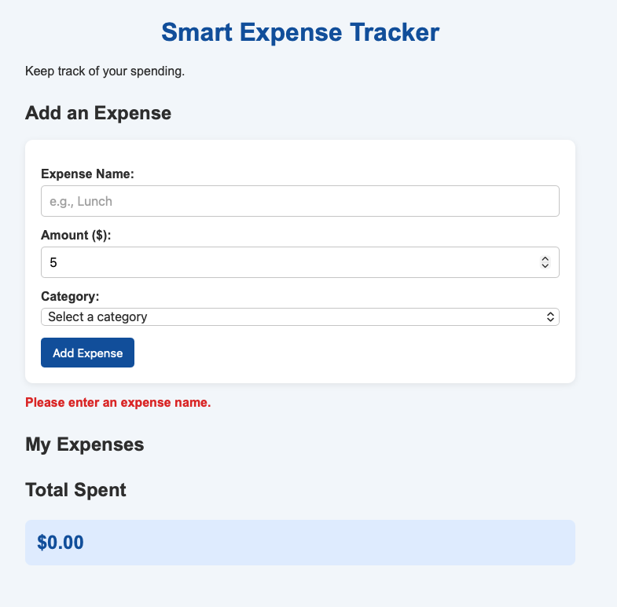
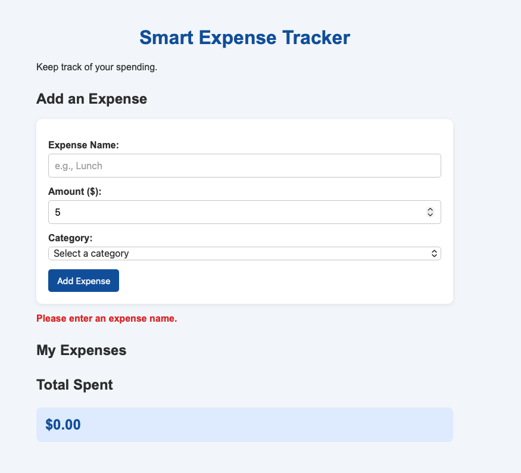
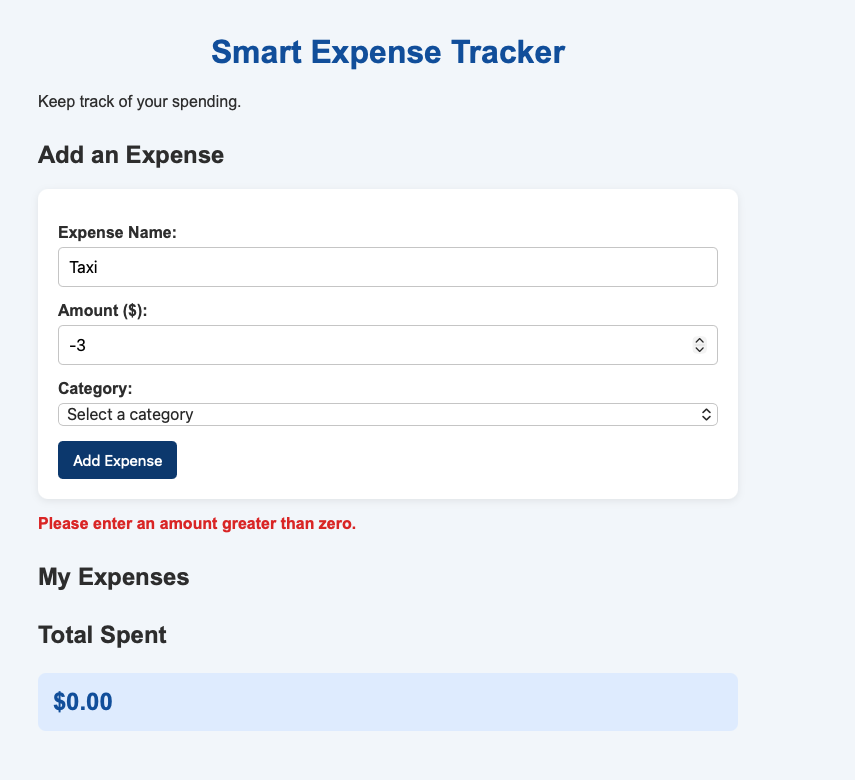
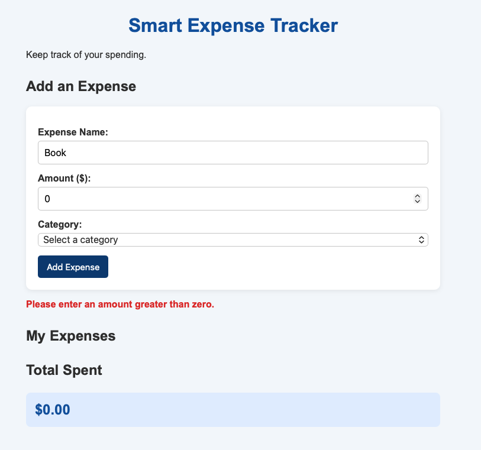
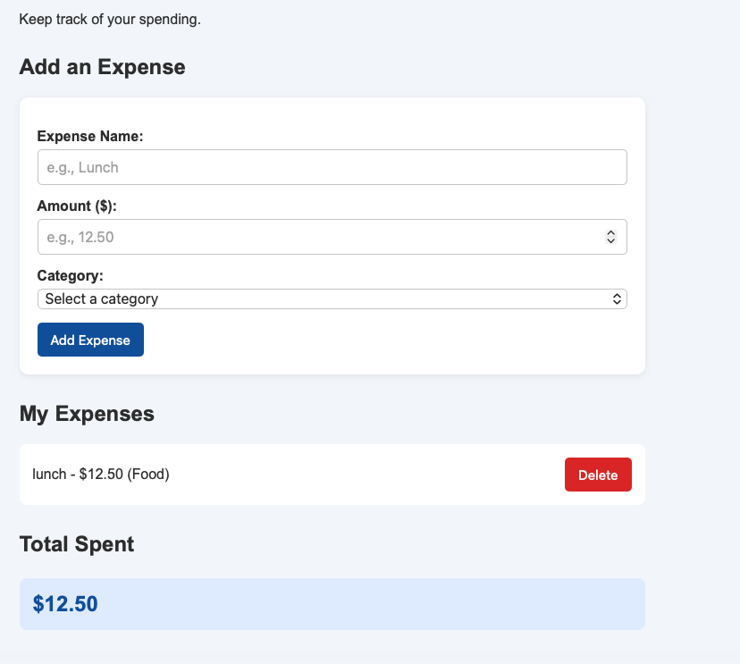

# Test Results

| Test            | Input                    | Expected                               | Actual Result                              | Status |
| --------------- | ------------------------ | -------------------------------------- | ------------------------------------------ | ------ |
| Valid expense   | Lunch, 12.50, Food       | Appears in the list, total shows 12.50 | Added to list, total 12.50                 | Pass   |
| Empty name      | "", 5                    | Error message, nothing added           | "Please enter an expense name"             | Pass   |
| Negative amount | Taxi, -3                 | Error message, nothing added           | "Please enter an amount greater than zero" | Pass   |
| Zero amount     | Book, 0                  | Error message, nothing added           | "Please enter an amount greater than zero" | Pass   |
| Delete an item  | Click Delete on one item | Item disappears, total updates         | Item removed, total updated                | Pass   |

## Screenshots

